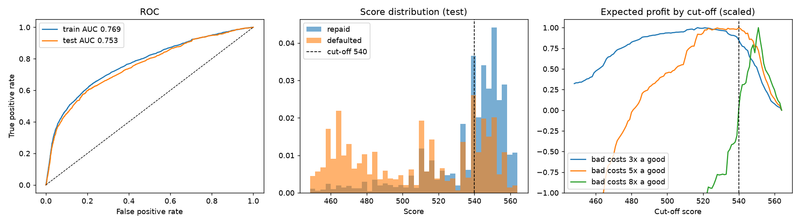

# Credit Card Default Scorecard

A bank-style **points scorecard** for predicting credit card default, built the way retail credit-risk teams build them: Weight-of-Evidence binning, a logistic regression, scaling to points, then validation with AUC/Gini, KS, calibration and PSI. On top of that come a cost-based cut-off and a fairness check.

[](https://github.com/vighnesh-shetty-vs/credit-risk-scorecard/actions/workflows/ci.yml)

**Data:** UCI *Default of Credit Card Clients* (Yeh & Lien, 2009). 30,000 real card customers of a Taiwanese bank: their credit limit, 6 months of repayment status, bills and payments (April–September 2005), and whether they defaulted the next month (22.1% did).



## Results (30% hold-out test set, 9,000 customers)

| Check | Result | What it means |
|---|---|---|
| AUC / **Gini** | 0.753 / **0.51** | Ranks customers by risk well: a random defaulter is ranked riskier than a random payer 75% of the time |
| **KS** | 0.40 | Max separation between the score distributions of payers and defaulters |
| 5-fold CV AUC (train) | 0.768 ± 0.008 | Stable across folds; train-test gap is 0.016 |
| Benchmark: gradient boosting | AUC 0.774 | The scorecard gives up 0.02 AUC to be fully explainable, point by point |
| Calibration | mean predicted PD 22.0% vs observed 22.1%; Brier 0.14 | PDs are usable as probabilities ([by decile](reports/calibration_test.csv)) |
| **PSI** train vs test | 0.001 | Stable (< 0.10). In production, the same check runs monthly on new applicants |
| Disparate impact (approval rate F/M) | 0.93 | Above the 0.8 rule of thumb, though sex is not a model input |

## The scorecard

Base score 600 corresponds to 50:1 good:bad odds, and **20 points double the odds**. Scores range from 449 to 564. Full table: [`reports/scorecard_points.csv`](reports/scorecard_points.csv).

| Feature (IV) | Riskiest bin → points | Safest bin → points |
|---|---|---|
| Last month's repayment status (0.89) | 3+ months late → 47 | paid / revolving on time → 100 |
| Worst delay in 6 months (0.78) | 2+ months → 73 | never late → 97 |
| Credit limit (0.19) | < 50k → 79 | ≥ 360k → 95 |
| Last payment amount (0.16) | < 326 → 81 | ≥ 10,233 → 94 |
| Share of bill paid, 5-month avg (0.12) | < 4% → 84 | ≥ 14% → 89 |
| Average utilisation, 6 months (0.08) | ≥ 45% → 85 | < 45% → 89 |

**How features were chosen** ([`reports/iv_table.csv`](reports/iv_table.csv)):
- Features with IV < 0.02 were dropped (age, bill amount).
- Of any pair with WoE correlation > 0.7, the weaker one was dropped (months delayed, last utilisation).
- Any feature whose coefficient flipped sign would also have been dropped. Every bin's points move in the intuitive direction.
- **Left out on purpose:** sex and marital status, under EU anti-discrimination rules for credit. Education was also left out: it's weak (IV 0.035), and its best-scoring group was the "other" bucket built from undocumented codes 0, 5 and 6, which is a data artefact rather than a risk signal.

## Credit policy memo: where to set the cut-off

**Decision:** which existing card customers to keep eligible for credit-line increases next month.

**Assumption:** a customer who stays good earns 1 unit of margin, and one who defaults loses 5 units. This is an illustrative ratio, not a figure from the data. Sensitivity to it is shown below.

| Policy | Approval rate | Default rate among approved | Expected result (test set) |
|---|---|---|---|
| Approve everyone | 100% | 22.1% | **−2,946** units |
| **Cut-off 540 (recommended)** | **54%** | **11.1%** | **+1,646** units |

- **Sensitivity:**
  - If a default costs 3× the margin, the cut-off falls to 517 (73% approved, 12.9% bad rate).
  - At 8× it rises to 551 (23% approved, 6.9% bad rate).
  - The cut-off is a business decision, and the model only tells you what each choice costs.
- **Fairness at 540:**
  - Women are approved at 56% and men at 52%.
  - Among approved customers, default rates are 10.6% (women) and 11.9% (men).
  - So the score isn't approving one group at a riskier standard.
- **Monitoring:**
  - Track PSI on the score and on each feature every month. Above 0.10, review; above 0.25, recalibrate.
  - Compare predicted PD with observed defaults by score band each quarter.

**Limitations:**
- The data has no application dates, so the split is random rather than out-of-time. A production model would be validated on a later period.
- Six months of history from 2005 Taiwan doesn't carry over directly to a European portfolio today; the method does.

## How it is built

```
scorecard/
  data.py      cleaning (undocumented codes, negative bills) + behavioural features
  binning.py   quantile bins merged until WoE is monotonic and every bin holds ≥5% of customers; WoE/IV
  metrics.py   Gini, KS, PSI, calibration table
  scaling.py   points = offset + factor·ln(odds), PDO 20
run_scorecard.py   split → bin → select → logistic regression → scale → validate → cut-off → fairness → reports/
tests/             7 unit tests: WoE/IV against a hand calculation, monotonic bins, KS/Gini extremes, PSI, PDO maths, cleaning
```

```bash
pip install -r requirements.txt
python scripts/download_data.py   # UCI dataset 350, SHA-256 verified
pytest -q
python run_scorecard.py           # writes reports/
```

CI runs the tests, rebuilds the model from the raw data and fails if test AUC drops below 0.74 or PSI goes above 0.10.

---

Vighnesh Shetty · [Portfolio](https://vighnesh-shetty-vs.github.io/portfolio-website-vighnesh/) · [LinkedIn](https://www.linkedin.com/in/vighnesh-shetty)
